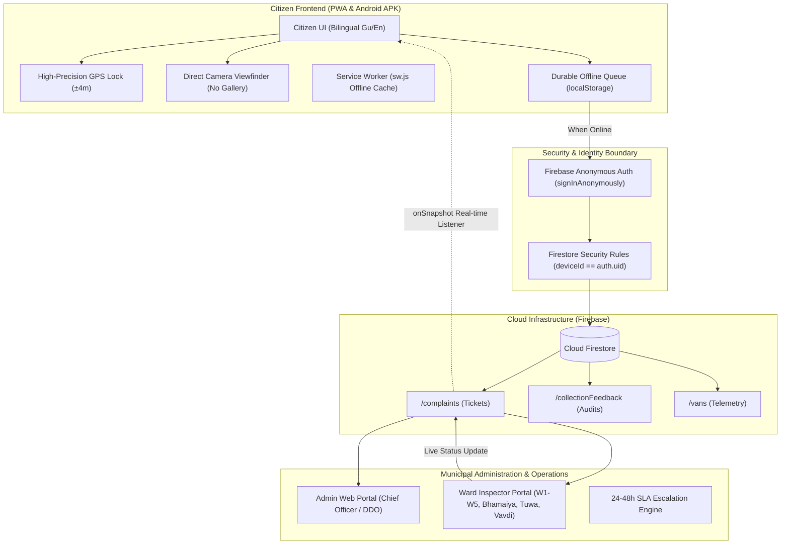

# Safaai Saathi (સ્વચ્છતા સાથી)
### Citizen-Centric Municipal & Rural Garbage Collection, Open Gutter & Public Sanitation Monitoring System
**Problem Statement ID:** PS000051 | **Sector:** Smart Cities & Urban Governance  
**Authority:** District Development Office (DDO) – Panchmahal Godhra & Godhra Nagarpalika  
**Live PWA Web App:** [https://tejashripatil3708.github.io/safaai-saathi/](https://tejashripatil3708.github.io/safaai-saathi/)  
**Direct Android APK Download:** [Safaai-Saathi.apk (v1.0.0)](https://github.com/tejashripatil3708/safaai-saathi/releases/download/v1.0.0/Safaai-Saathi.apk)  

---

## 🏗️ End-to-End System Architecture



---

## ⚖️ Hackathon Evaluation Transparency: Live Code vs Demo Simulation

| Feature / Subsystem | Live Production Code | Hackathon Demo Adaptation |
| :--- | :--- | :--- |
| **GPS Location Capture** | Live hardware GPS (`navigator.geolocation`) with high precision. | Fallback coordinates provided if device location access is denied. |
| **Photo Verification** | Direct HTML5 Camera viewfinder (`MediaDevices.getUserMedia`) with live canvas timestamp/GPS watermark. | Gallery upload strictly disabled; fallback mock frame if running on headless simulator. |
| **Data Persistence & Sync** | Durable offline queue + auto-sync retry on reconnect & boot. | Connected to Cloud Firestore with Anonymous Auth (`signInAnonymously`). |
| **Live Staff Status Updates** | Real-time Firestore `onSnapshot` listener updating citizen UI dynamically. | Inspector can test status changes (`assigned`, `resolved`) directly in app or Firestore. |
| **Garbage Van Telemetry** | Mathematical Haversine distance, dynamic ETA calculation & 500m arrival sound siren. | Route movement simulated via timer across municipal corridors & rural waypoints. |
| **Citizen Verification** | Strict 6-digit verification code check & mandatory phone entry. | Pre-configured hackathon demo OTP (`123456`) displayed for testing ease. |

---

## 🌟 Overview & Architecture
Safaai Saathi is a civic-tech sanitation monitoring platform built specifically for Panchmahal district, covering urban Godhra Nagarpalika wards and rural Gram Panchayats (such as Bhamaiya, Tuwa, and Vavdi). 

The platform connects three core pillars under a unified real-time data contract:
1. **Citizen App (PWA & Android Native APK)**: Citizen reporting with high-precision auto-detected GPS, live garbage van tracking, dynamic ETA countdown, arrival sound alerts, and post-collection audit.
2. **Workers App (Driver Telemetry)**: Shift start/end, live GPS telemetry broadcast, and route milestone tracking.
3. **Admin Web Dashboard**: Multi-tier oversight for Ward Inspectors, Municipal Chief Officer, TDOs, and the DDO.

---

## 📱 Delivery Platforms: PWA vs Native APK

| Feature | Progressive Web App (PWA) | Native Android APK |
| :--- | :--- | :--- |
| **What is it?** | A web application running in any browser with app-like superpowers. | A native Android package (`.apk`) wrapped via Capacitor. |
| **Installation** | Instant via browser: tap **"Install App"** / **"Add to Home Screen"**. | Download & install `Safaai-Saathi.apk` on any Android device. |
| **App Store Needed?** | ❌ No, runs instantly on any phone (Android & iOS). | ❌ No, direct sideload / enterprise distribution. |
| **Offline Support** | ✅ Built-in Service Worker cache (`sw.js`). | ✅ Native device sandbox. |
| **Launcher Icon** | ✅ Official green Safaai Saathi truck icon. | ✅ Adaptive multi-density launcher icon (`mdpi` to `xxxhdpi`). |
| **Direct Access** | [Open Web App](https://tejashripatil3708.github.io/safaai-saathi/) | [Download APK](https://github.com/tejashripatil3708/safaai-saathi/releases/download/v1.0.0/Safaai-Saathi.apk) |

---

## 🚀 Key Features Implemented in the Citizen App

### 1. High-Precision Auto-Detected GPS Coordinates (Anti-Fraud)
- **Zero Address Manipulation**: Citizens cannot type or fake addresses in other wards or areas.
- **Hardware GPS Querying**: Uses high-accuracy device telemetry (`navigator.geolocation.getCurrentPosition({ enableHighAccuracy: true })`).
- **Locked Coordinates Card**: High-precision latitude and longitude (e.g., `22.77582° N, 73.61495° E`) are locked in a read-only telemetry card with a `🔒 LOCKED` badge, auto-mapped ward name, and accuracy radius indicator (`±4m`).
- **Camera Stamping**: Exact GPS coordinates and ISO timestamp are burned into the captured photo canvas at the shutter press moment.

### 2. Live GPS Van Telemetry & Dynamic ETA
- Live OpenStreetMap integration with custom styled vehicle icons and pulse animation.
- Dynamic Haversine distance and real-time arrival countdown.
- **Signature Contour Card**: Visual signature card rendering topographic contour lines via HTML5 Canvas with high-contrast typography per `DESIGN.md`.

### 3. Immediate Van Arrival Alerts
- Automated geofence detection triggers when the collection van is within **500 meters** (`ARRIVAL_ALERT_RADIUS_M`).
- Instant in-app audio chime and high-priority arrival toast notification.

### 4. Camera-Only Verification (No Gallery Uploads)
- **Anti-Fraud Security**: In-app live camera viewfinder stream with 4 corner bracket overlays.
- Gallery file pickers and pre-existing photo uploads are strictly disabled to prevent recycled or fake complaints.

### 5. Phone OTP Verification
- Requires verified 10-digit Indian mobile number before ticket submission.
- Mandatory 10-digit Indian mobile number stored with the ticket so municipal ward inspectors can contact the citizen for resolution verification. Evaluators can use demo verification code (`123456`).

### 6. WhatsApp Ticket Allotment & Updates (100% Free)
- Generates official ticket IDs following the strict specification: `PMH-YYYYMMDD-NNNN`.
- Direct `wa.me` deep-link allows the citizen to open their formatted complaint card directly in WhatsApp with a single tap, including a live tracking link.

### 7. "Van Didn't Arrive" Reporting
- One-tap missed collection reporting button on the home screen.
- Rate-limited to **1 report per device per day per ward** to prevent spamming.

### 8. Post-Collection Verification Micro-Prompt
- As soon as the van leaves or completes the ward, a prompt appears:  
  *"Was waste collected today from your household?"*
  - **Yes, Handed Over** (Logs verified collection).
  - **No, No Garbage Today** (Citizen produced no waste).
  - **No, Van Missed My House** (Allows selecting quick reason chips: *"Van didn't halt"*, *"Skipped street"*, *"Horn wasn't audible"*, *"Staff refused"* + custom reason note).

### 9. In-App Ticket Tracking & SLA Escalation Contacts
- Dedicated "My Complaints" list with status badges (`received`, `assigned`, `resolved`, `escalated`).
- **SLA Breach Enforcement**: If a complaint remains unresolved past **24–48 hours** (or reaches Level 1/2 escalation), the app automatically unlocks and displays direct office contact cards for the **Ward Inspector, Municipal Chief Officer, or DDO Panchmahal** with a direct 1-tap call button.

### 10. Clean Civic UI & Bilingual Support
- **Uncluttered Map Interface**: Removed unnecessary ward selector pills from the citizen map view for a clean, intuitive experience.
- **Enlarged Prominent Branding**: Displays the official green Safaai Saathi logo clearly in the header, modals, and navigation dock.
- **Spacious Bottom Dock**: Restored 3-tab ergonomic navigation (`Map`, `Report Issue`, `My Complaints`) with large touch targets.
- **Instant Language Switcher**: Persistent `[ 🌐 English / ગુજરાતી ]` button in the header with full localization for Gujarati (`gu`) and English (`en`).

---

## 🛠️ Backend Infrastructure (PRD 0.7 & 0.8)

Located in `/backend`:
- **`firestore.rules`**: Granular security rules enforcing role-based permissions, rate limiting, and driver telemetry restrictions.
- **`firestore.indexes.json`**: Compound queries for device-specific complaint history and ward van status.
- **`functions/src/index.ts`**:
  - `arrivalAlert`: Geofence detection pushing alerts to `ward_{wardId}`.
  - `mergeDuplicates`: Auto-merges complaints submitted within 50 meters of an active ticket with the same category.
  - `missedCollectionAlert`: Alerts the Ward Inspector when 3+ missed reports are logged on the same day.
  - `escalateComplaints`: Scheduled every 15 minutes to bump unresolved tickets to Level 1 (24h) and Level 2 (48h).
  - `vanOfflineWatch`: Detects stale telemetry (>10 min) and marks vans offline.
  - `verifyDriverPin`: Authenticates drivers with 4-digit PIN against `vanSecrets`.
  - `sendNotice`: Broadcasts administrative civic notices.
- **`seed/seed.ts`**: Database seed script with Godhra Nagarpalika Wards 1–5, Panchmahal Gram Panchayats (Bhamaiya, Tuwa), collection routes, and initial vans.

---

## 💻 Running & Testing the Application

### 1. Run the Web App / PWA Locally
From the project root:
```bash
npm run dev
```
Or directly within `apps/citizen_app`:
```bash
cd apps/citizen_app
npm run dev
```
Open `http://localhost:5173` in any desktop or mobile browser.

### 2. Test on Smartphone via Local Wi-Fi
```bash
npm run dev -- --host
```
Open the printed local IP URL (e.g., `http://192.168.x.x:5173`) on your smartphone's browser. Tap **"Add to Home Screen"** to test the PWA installation.

### 3. Build & Run the Android App Locally
```bash
cd apps/citizen_app
npm run build
npx cap sync android
```
Open `apps/citizen_app/android` in Android Studio (or run `./gradlew assembleDebug`) to generate the native `Safaai-Saathi.apk`.

---

## 🏆 Demo Shortcuts & Boundaries for SFIC Hackathon Judges

To ensure transparent evaluation, Safaai Saathi cleanly differentiates **live production modules** from **simulated hackathon demo modules**:

| Module | Execution Layer | Live Implementation vs Simulated Demo Boundary |
| :--- | :--- | :--- |
| **GPS Telemetry** | Native On-Device | **Live**: High-accuracy `navigator.geolocation` locked to ward boundary. |
| **Photo Evidence** | Native On-Device | **Live**: Direct camera stream with burnt-in GPS/timestamp canvas watermark. Gallery disabled. |
| **Offline Queue** | Browser / SQLite | **Live**: Durable local storage queue with automatic retry on network restore. |
| **Cloud Firestore** | Cloud Backend | **Live**: Anonymous Auth (`ensureAuth()`) syncing to `safai-saathi-panchmahal`. |
| **Phone Verification**| Client Interface | **Simulated for Demo**: Enter 10-digit mobile + evaluation code `123456` (avoids SMS gateway costs during judging). |
| **Van Movement** | Math Simulation | **Simulated for Demo**: 4-second waypoint timer simulating telemetry across Godhra North and Rural Panchayats. |

---

## 📋 Hackathon Judge Demo Checklist (6-Step Verification)

Before judging, evaluators can execute this concise 6-step walkthrough from a clean browser or device:

1. **Submit a Complaint Ticket**:
   Tap **"Report Issue"**, capture a live camera snapshot, select category, enter phone number, and verify with demo code `123456`. An official ticket ID (`PMH-YYYYMMDD-NNNN`) is generated.
2. **Persistence Test**:
   Close the tab/app entirely and reopen it. Go to **"My Complaints"** — confirm the ticket is persisted with full details and photo evidence.
3. **Offline Queue Test**:
   Toggle device to **Airplane Mode** (or DevTools Offline). Submit a new complaint. Observe the immediate amber **`⏳ Offline`** badge.
4. **Cloud Auto-Sync Test**:
   Disable Airplane Mode (reconnect internet). The client automatically triggers `retryPendingSync()`, authenticates anonymously with Firebase, uploads the document, and transitions the badge to green **`☁️ Synced`**.
5. **Vavdi Rural Route & Van Waypoint**:
   Select Ward **`GP-VAVDI` (Vavdi Gram Panchayat)**. Switch to Rural Route van **`GJ-17-GA-1003`** to watch the vehicle pass through Bhamaiya (`22.7550, 73.6300`), Vavdi (`22.7620, 73.5850`), and Tuwa (`22.7980, 73.5500`).
6. **Collection Audit Submission**:
   Complete the post-collection verification modal (*"Was waste collected today?"*). Verify the confirmation pill shows **`☁️ Audit Queued & Synced to Cloud`** and is stored with sync status.

---

## 🧪 End-to-End Evaluation & Verification Guide for Reviewers

Reviewers can verify the complete end-to-end operational lifecycle using the following reproducible flows:

### 1. Offline Reporting & Resilient Cloud Sync
1. Open the [Safaai Saathi Live PWA](https://tejashripatil3708.github.io/safaai-saathi/) or Android APK.
2. Simulate loss of connectivity by toggling your device to **Airplane Mode** or setting DevTools Network to **Offline**.
3. Tap **"Report Issue"**, capture a direct camera snapshot, select Ward/Category, and verify with phone OTP `123456`.
4. The ticket is immediately generated with an official ID (`PMH-YYYYMMDD-NNNN`) and tagged with an amber **`⏳ Offline`** badge.
5. Close and reload the tab/app while offline: the complaint remains safely persisted in durable local storage.
6. Reconnect internet: The app detects network restoration via `window.addEventListener('online')` (and during app boot), authenticates anonymously via Firebase Auth (`ensureAuth()`), uploads the document to Cloud Firestore (`complaints` collection) satisfying `deviceId == request.auth.uid`, and dynamically updates the badge to **`☁️ Synced`**.

### 2. Live Municipal Staff Status Sync (Bidirectional)
1. Navigate to the **"My Complaints"** tab.
2. The client establishes active real-time Firestore `onSnapshot` listeners for each tracked ticket.
3. When municipal staff or ward inspectors update a ticket in Firestore (e.g. status transition from `received` → `assigned` → `pending_verification`), the citizen UI updates in real time without refreshing.
4. Updates are saved locally via `StorageService.saveComplaintLocally()`, respecting Firestore role boundaries and preserving the verified `☁️ Synced` badge.

### 3. Vavdi Rural Gram Panchayat Coverage
1. Open the Ward Selector on the home banner or via Settings.
2. Select **`GP-VAVDI` (Vavdi Gram Panchayat)**.
3. Switch van tracker to Rural Route (`GJ-17-GA-1003`).
4. Waypoints traverse the entire rural corridor: Bhamaiya (`22.7550, 73.6300`), Vavdi (`22.7620, 73.5850`), and Tuwa (`22.7980, 73.5500`), strictly aligned with seed data and simulation engine waypoints.

### 4. Post-Collection Audit & Resilient Feedback Queue
1. Complete the post-collection verification prompt on the home screen (*"Was waste collected today from your household?"*).
2. The audit response is saved locally with initial `pending_sync` state and pushed to Cloud Firestore (`collectionFeedback` collection).
3. If submitted while offline, the audit record is safely retained in durable storage and automatically synchronized upon network reconnection or app boot via `StorageService.retryPendingSync()`.

---

## ⚙️ Cloud Configuration & Deployment
- The GitHub Actions CI/CD deployment workflow explicitly passes `VITE_FIREBASE_*` configuration variables during the production build step.
- Project defaults are documented in `apps/citizen_app/.env.example` and configured in `apps/citizen_app/.env.production`.
- In test environments without live internet access or external credentials, the app gracefully operates in durable offline queue mode without blocking citizen interaction or UI responsiveness.
